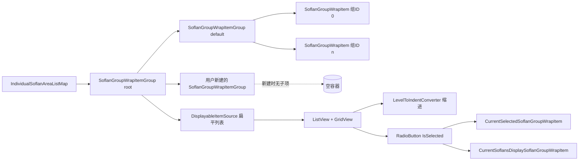

# ISF 变速分组树状显示：现状审查与重构建议

- 日期：2026-10-22
- 基线：`master` `4c9bff35`（PR #46 已回滚；本文件针对当前 master，不是 `9171b339`）
- 范围：`Modules/FumenSoflanGroupListViewer/**`、`Base/EditorObjects/SoflanGroupWrapItem*.cs`、`Base/Collections/IndividualSoflanAreaListMap.cs`、SGWI 持久化、拖拽管理器，以及依赖组树状态的绘制/明细链路
- 状态：**已按方案 E 实施（2026-10-22）**，审查部分保留为设计记录
- 关联：上一版 `docs/soflan-group-viewer-audit-2026-10-22.md` 基于已回滚的 PR #46，其 SG-1/SG-2 等条目描述的是 PR 内容；当前 master 的结论以本文件为准
- PR #46 功能需求：[`pr46-isa-placement-soflan-group-functional-requirements.md`](pr46-isa-placement-soflan-group-functional-requirements.md)（历史需求，不代表当前实现）

## 实施结果（方案 E，2026-10-22）

已按方案 E 落地：组文件夹（Category）扁平在根级，只能包含 Group，不能相互嵌套；Group 为叶节点；旧的双层 `SoflanGroupWrapItem` 模型已删除。

- **模型**：`Modules/FumenSoflanGroupListViewer/Models/SoflanGroupTree.cs`（`SoflanGroupTreeNode` / `SoflanGroupCategoryNode` / `SoflanGroupNode` / `SoflanGroupTree`）、`SoflanGroupTreeSerialization.cs`、`SoflanGroupColor.cs`。
- **持久化**：组树布局改由**项目文件**（`*.nyagekiProj` 的 `SoflanGroupTree` 节点）持有；`EditorProjectDataUtils` 在项目保存前 `Capture`、加载后 `Apply`。谱面文件不再写 `[SGF]`/`[SGC]`/`[SGWI]`；旧谱面中的这些行仍会被解析用于迁移。
- **加载**：`OngekiFumen.Setup`、ISoflan `AddObject`、ISA `Add` 都会确保组节点；仅由 Soflan 引用的组现在会出现在树中。
- **显示**：`TreeView` + `SoflanGroupTreeNodeViewModel` + `SoflanGroupNameDialogView`；工具栏按钮为「新建变速组」（Group）、「新建组文件夹」（Category）、重命名、删除、移动到根，五个按钮均有 ToolTip；两个新建按钮都弹窗输入名称，空名分别使用「新的变速组」/「新的组文件夹」（文件夹重名自动追加序号），工具栏不再保留输入框；拖拽 Group 到文件夹或根、Group 文件夹仅在根级重排；`SelectedItem`/`IsSelected` 双向同步；右侧明细只显示左侧选中的变速组；选中组文件夹时不显示明细内容，已移除 Group 列。Design/Preview/Draw 三列分别带 D/P/S 标签，使用固定列并抵消 TreeView 层级缩进，跨层级对齐；每个开关的 ToolTip 根据当前勾选/选中状态动态说明功能。变化列表标题包含组号（如 `#10`）。无活跃编辑器或编辑器没有谱面时，查看器根容器 `IsEnabled=false`，工具栏/树/明细整体禁用。
- **显示状态**：组行 Design/Preview 复选（分类联动子项）、Draw 单选；`IFumenSoflanGroupListViewer` 改为 `CurrentSelectedSoflanGroupId` / `DrawnSoflanGroupId` / `IsGroupVisible`；`DurationSoflanDrawingTarget`、`DrawJudgeLineHelper`、状态栏与可见性检查已适配。
- **数值显示**：属性编辑器、Soflan 明细、拍号/元信息 BPM、音频调整、TGrid 计算器、子弹速度、设置项以及 `TGrid`/`XGrid`/对象 `ToString` 统一格式化，避免 float/double 二进制噪声直接显示。
- **颜色**：`SoflanGroupColor` 改为黄金角色相步进（137.508°）+ 固定 S=0.9/V=1.0 的明亮配色；组 ID 稳定、跨会话一致，前 16 组色相间隔 ≥ 12°，相邻新建组不会落到相近色相；树节点显示颜色块，ISA 区域与对象 tint 使用同一颜色。
- **默认组**：ID 0 显示为「默认变速组」，提供说明性 ToolTip，并在视图/model 层禁止拖动；
- **删除**：默认变速组、仍有子节点的分类、仍被引用的组会被拒绝并提示；空组/空分类可删除且可撤销。
- **清理**：删除 `SoflanGroupWrapItem`、`SoflanGroupWrapItemGroup`、`SoflanGroupDisplayItemListViewBase`；`IndividualSoflanAreaListMap` 改为持有 `SoflanGroupTree`。

已知边界（有意收敛，不是未完成项）：

- Group 是叶节点；组文件夹不嵌套，固定为根级，只能包含 Group；Group 可以直接在根或位于某个组文件夹内。
- 拖拽只追加到目标分类/根，没有同级精确插入位置指示。
- 删除采用“有引用则拒绝”策略，尚未实现引用转移/连同引用删除对话框。
- 名称唯一性只约束根级组文件夹；Group 允许重名（ID 唯一）。
- 旧版嵌套组文件夹路径在解析时合并为一个根级名称（如 `A/B`），不会在树中重建嵌套层级。
- 单独打开谱面文件（不经过项目）或旧编辑器打开新谱面时，组布局不可用；布局只随项目文件保存。
- Design/Preview/Draw/展开/选中状态不持久化（与重构前一致）。

验证：

- Debug/Release 构建 0 error。
- `tests/soflan-group-tree`：241 项检查通过（模型、组文件夹不可嵌套、移动/防环、删除恢复、旧 SGWI 迁移、属性编辑器数值格式、项目树 Capture/Apply（含清理谱面遗留分类）、项目 JSON 往返、项目保存 Capture、项目加载 Apply、仅 Soflan 组、名称转义、默认组、新颜色亮度/饱和度/撞色检查）。
- 后台 GUI 冒烟（UIAutomation）：打开带音频工程、创建组、删除并撤销、重命名对话框、空名新建默认命名、无编辑器/关闭编辑器时整体禁用、组文件夹根级平铺、树/右侧明细渲染；日志无异常。

## 重构前实现（历史）



- 数据模型：`IndividualSoflanAreaListMap` 持有 `SoflanGroupWrapItemGroupRoot`，其中固定有 `defaultItemGroup`；每个 `SoflanGroupWrapItem` 是一个组 ID，`Parent` 指向名称容器。
- 显示：`ListView` 绑定 `DisplaySoflanGroupItemGroupRoot.DisplayableItemSource`（由 `SoflanGroupWrapItemGroup` 递归扁平化），用 `LevelToIndentConverter` 缩进模拟树；展开/折叠由自定义 `Expander` 切换 `IsExpanded`。
- 交互：选中由 Name 列 `RadioButton` 驱动（`OnItemChecked` → `CurrentSelected`）；Soflans 列是另一组全局互斥 `RadioButton`（`CurrentSoflansDisplay`）；拖拽由 `ListViewDragDropManager` 按扁平索引处理，只允许移动 `SoflanGroupWrapItem`。
- 持久化：`[SGWI] <组名> <id...>`，formatter 只遍历 `IndividualSoflanAreaMap.Keys`（有 ISA 的组），parser 从 root 直接子组按组名查找。

## 问题清单

### TR-1（高）新建组只创建空容器，无法选中/查看/使用

- **位置**：`FumenSoflanGroupListViewerViewModel.CreateNewGroup`（`:116-147`）、XAML Name 列（`:178-192`）、`IndividualSoflanAreaListMap`（`:41-61`）
- **现象**：`CreateNewGroup` 只 `new SoflanGroupWrapItemGroup { DisplayName }` 并 `root.Add(group)`，没有创建 `SoflanGroupWrapItem`（组 ID）。`CurrentSelected`、`OnItemChecked`、`DisplaySoflanPointList`、Soflans 列都只接受 `SoflanGroupWrapItem`；组容器的 RadioButton 绑定 `IsSelected`（基类没有该属性）而不可见/不可选。
- **影响**：用户新建的组是一个“装饰性空行”：不能选中、右侧没有明细、不能勾选 Soflans、不能作为组 ID 使用。当前 master 的“新建组”功能实际上不可用；只有默认组和 parser 从 SGWI 创建的组项可用。
- **建议**：按 TR-7 改为“组即节点（节点本身带 ID）”；若暂时保留双层结构，新建组时必须同时创建 `SoflanGroupWrapItem` 并分配唯一 ID。

### TR-2（高）模型与视图耦合，组树是 `ListView` 伪树

- **位置**：`Base/EditorObjects/SoflanGroupWrapItemGroup.cs`（整个文件）、`SoflanGroupDisplayItemListViewBase.cs`、XAML `ListView`（`:67-264`）
- **现象**：`SoflanGroupWrapItemGroup` 同时承担模型角色（被 `IndividualSoflanAreaListMap`、formatter、parser 引用）和 UI 状态（`Parent/Level/IsExpanded/HasChildren/IsSelected/IsDisplayInDesignMode/IsDisplayInPreviewMode/DisplayableItemSource`），位于 `Base/EditorObjects` 且引用 Caliburn.Micro。显示层用扁平列表 + `Level` 缩进 + 自定义 Expander 模拟树。
- **影响**：模型变更必须同步维护缓存/通知/层级；树操作（展开、拖拽、选中）都是手写逻辑；层级扩展（真正嵌套）容易出错；难以对模型做无 UI 单元测试。
- **建议**：拆为纯模型（ID/名称/父子/顺序/引用计数）+ 节点 ViewModel（展开/选中/可见/颜色）；显示改用 `TreeView` + `HierarchicalDataTemplate`（或 `TreeListView`），由 WPF 管理展开与缩进。

### TR-3（高）选中语义与行选择脱节

- **位置**：`FumenSoflanGroupListViewerView.xaml` 的 `ListView SelectionMode="Single"`（`:74`）与 RadioButton（`:178-192`）、`OnItemChecked`（`:210-219`）
- **现象**：`CurrentSelectedSoflanGroupWrapItem` 只由 Name 列 `RadioButton.Checked` 设置；点击行文本/空白只改变 `ListView` 自身的选中高亮，不改变右侧明细/当前组。组容器行没有可用的 RadioButton（绑定不存在的 `IsSelected`），完全不可选。
- **影响**：用户必须精确点击小圆点才能切换组；点击行“看起来选中了”但右侧不更新；组容器无法成为当前组，无法查看/勾选。
- **建议**：改用 `TreeView.SelectedItem`（或 `ListView.SelectedItem`）绑定单一 `SelectedGroup`；行点击即选中；组节点统一可选。

### TR-4（高）拖拽索引/目标语义不完整

- **位置**：`ListViewDragDropManager.listView_Drop`（`:319-390`）、`ListDragManager_ProcessDrop` / `CreateMoveAction`（`:263-335`）
- **现象**：
  - 鼠标不在任何项上（列表空白/末尾）时 `newIndex < 0` 且 `oldIndex >= 0` → 直接 return，无法拖到列表末尾；
  - 拖到组行只会追加到该组末尾，不能插到组前/组之间；
  - 只能拖 `SoflanGroupWrapItem`，组容器不可拖、不可重排、不可嵌套；
  - 扁平索引与父组索引的换算依赖 `ElementAtOrDefault(e.NewIndex)`，目标为空/末尾时 `placeTo == null`，操作被静默丢弃。
- **影响**：无法整理组顺序/层级；拖到空组/末尾时无反馈；重构为真正树后现有拖拽实现不可复用。
- **建议**：TreeView 自定义拖拽：目标行上半/下半决定插入位置，拖到组行=移入并追加，拖到空白=根末尾；组节点可拖动改变父子/顺序，并做环检测；拖拽失败给 Toast 或禁止指示。

### TR-5（中）扁平化缓存/刷新导致滚动与性能问题

- **位置**：`SoflanGroupWrapItemGroup.DisplayableItemSource`（`:63-84`）、`NotifyItemSourceChanged`（`:142-147`）、`RebuildItemGroupRoot`（`:221-253`）
- **现象**：任何 `Add/Remove/IsExpanded` 都会清空 `cachedDisplayableItemSource` 并沿父链冒泡；`ListView` 绑定的是这个扁平 `List`，每次变化全量重新绑定；`RebuildItemGroupRoot` 还先置空再赋 root。滚动位置会回到顶部，组多时刷新开销明显。
- **建议**：TreeView 节点集合原地更新；`IsExpanded/IsSelected` 保存在节点 VM；避免每次变化重建扁平列表；保留滚动/焦点。

### TR-6（中）三套显示状态 + 两个“当前组”

- **位置**：`SoflanGroupDisplayItemListViewBase`、`SoflanGroupWrapItemGroup`、XAML 三列（Design/Preview/Soflans）、`DisplaySoflanPointList`（`:93-107`）、`DurationSoflanDrawingTarget`（`:194`）
- **现象**：
  - `IsSelected`（单选）、`IsDisplaySoflanDesignMode`（单选绘制）、`IsDisplayInDesignMode/Preview`（复选）三套状态；
  - `CurrentSelectedSoflanGroupWrapItem`（右侧明细）与 `CurrentSoflansDisplaySoflanGroupWrapItem`（绘制/判定线颜色）并存；
  - Soflans 列是 RadioButton（全局单选），但右侧明细仍跟 `CurrentSelected`，用户容易以为勾选 Soflans 会切换明细。
- **建议**：收敛为 `SelectedGroup` + `VisibleInDesign`/`VisibleInPreview` + `DrawSoflans`（改为复选或明确“当前绘制组”）；右侧明细只跟 `SelectedGroup`；在 ToolTip/列头写明语义。

### TR-7（中）组概念双层（名称容器 + ID 项）且显示语义混乱

- **位置**：`IndividualSoflanAreaListMap` 的 `defaultItemGroup` 与 `TryGetOrCreateSoflanGroupWrapItem`（`:41-61`、`:134-139`）、parser（`:18-39`）、formatter（`:78-86`）
- **现象**：UI 显示 `default`（名称容器）与 `默认组（0）`/`SoflanGroup #N`（ID 项）两层；新建组只创建名称容器；`[SGWI]` 一行名称可包含多个 ID；`SoflanGroupWrapItem.DisplayName` 的 setter 为空（item 名只读）。
- **影响**：用户无法从界面理解“组名”和“组 ID”的关系；一个名称下的多个 ID 无法单独命名；新建组与已有 ID 无法绑定。
- **建议**：改为“一个组 = 一个节点（ID + 名称 + 父/顺序）”；默认变速组（ID 0）作为特殊根节点；同一旧 SGWI 行的多个 ID 迁移为兄弟节点（名称加后缀或保留别名）；持久化每个组一行。

### TR-8（中）组名无法编辑/重命名

- **位置**：`SoflanGroupWrapItem.DisplayName`（`set { }`）、`SoflanGroupWrapItemGroup.DisplayName`（可写但无 UI）、Name 列 `TextBlock`
- **影响**：建错名只能删除重建；空容器名字不可改；组名是 SGWI 的唯一键，改名影响持久化（当前无入口）。
- **建议**：Name 列双击编辑（TextBox，失焦/回车提交，带撤销）；与 TR-7 的节点模型一并实现。

### TR-9（中）持久化只按名称、无层级/顺序、重名合并

- **位置**：`DefaultOngekiFumenFormatter.ProcessSoflanGroupWrapItem`（`:78-86`）、`SoflanGroupWrapItemCommandParser`（`:18-39`）
- **现象**：
  - formatter 只遍历 `IndividualSoflanAreaMap.Keys`（有 ISA 的组），仅 Soflan 引用的组、空组不写；
  - 按 `Parent.DisplayName` 分组，重名组合并成一行；
  - parser 从 root 直接子组按名称查找，层级被拍平；
  - 加载时 parser 先设置 `SoflanGroup`、后 `AddObject`，不会创建组项，仅有 Soflan 引用的组不出现在树中（与 TR-1 相关联）。
- **影响**：组名/空组/层级/顺序不可靠；重载后组结构可能与编辑时不同。
- **建议**：新格式包含 ID/父 ID/名称/顺序（如 `[SGF]`）；兼容旧 `[SGWI]`（按名称+ID 列表迁移）；加载时补齐 `SoflansMap.Keys` 的节点；名称唯一性校验。

### TR-10（中）默认组/default 容器硬编码、中英混杂

- **位置**：`IndividualSoflanAreaListMap`（`:41-51`，`"root"`/`"default"`）、`SoflanGroupWrapItem` 构造（`"SoflanGroup #N"`/`"Default ..."`）、XAML 列头（`Name/Design/Preview/Soflans` 硬编码英文，ToolTip 有本地化）
- **影响**：界面中英混杂；内部标识与显示名耦合；本地化无法覆盖。
- **建议**：内部用引用/枚举标识；`default` 容器显示本地化名称（或不显示）；列头/默认组名走资源。

### TR-11（中）Soflans 列/绘制行为不可发现

- **位置**：`DurationSoflanDrawingTarget`（`:194` 只绘制 `IsDisplaySoflanDesignMode` 的组）、`DrawJudgeLineHelper`（`:87` 读取 `CurrentSoflansDisplay`）、XAML Soflans 列（`:238-261`）
- **现象**：Soflans 列是全局单选，控制画布上只绘制哪一组的变速线；默认组 0 在 `Setup` 中为 true，新建/parser 组默认 false；列头是英文且与右侧明细无关。
- **影响**：用户可能看不到非默认组的变速线，误以为组为空；两个“当前组”语义难理解。
- **建议**：改为“绘制变速线”复选（或单选但明确高亮当前绘制组）；新建组默认继承当前绘制组或给出提示；列头/ToolTip 三语。

### TR-12（低）异常/空引用/事件健壮性

- **位置**：`OnItemChecked`（`:210-219`）与 `OnItemChecked_IsDisplaySoflanDesignMode`（`:199-208`）的 `throw new Exception`；`SoflanGroupWrapItemGroup.IsDisplayInDesignMode/Preview` setter 的 `isUpdatingChildrenCount++` 无 `try/finally`；`CreateNewGroup` 的中/英文 MessageBox 文案硬编码；`RebuildItemGroupRoot` 在无 Fumen 时清空选择。
- **影响**：绑定顺序异常时 UI 事件抛异常可能崩溃；子项 setter 抛异常后联动计数不恢复。
- **建议**：改为 Log/忽略；try/finally；资源化文案；明确空 Fumen 状态。

### TR-13（低）组树缺少模型级测试

- **现状**：`SoflanGroupWrapItemGroup` 的 Add/Remove/Level/缓存/移动、SGWI 往返、重名/层级、默认组行为均无单元测试；PR #46 的 `tests/isa-placement` 已随 PR 回滚，且包含 UI/反射耦合。
- **建议**：重构前先补纯模型测试（无 WPF/IoC）：父子/顺序/移动/防环/默认组/序列化往返/仅 Soflan 组补齐。

### TR-14（低）颜色不稳定、无图例

- **位置**：`IndividualSoflanAreaDrawingTarget.CalculateColorBySoflanGroup` 的 `colorSeed = RandomHepler.Random(...)`（进程随机）
- **影响**：同一组 ID 每次启动颜色不同；组树无颜色列/图例，无法用颜色识别组。
- **建议**：确定性颜色（组 ID 稳定哈希）；节点 VM 暴露颜色，Name 列前加色块。

---

## 重构方案对比

| 方案 | 做法 | 优点 | 缺点 |
|---|---|---|---|
| A | 组即节点（ID+名称+父/顺序，无 Category）+ `TreeView`/`HierarchicalDataTemplate` | 模型/视图分离；真正层级；行选中/展开/缩进由 WPF 管；扩展拖拽/重命名/右键菜单容易 | 旧 SGWI 的“名称容器 + 多 ID”语义需要拆分为兄弟节点；改动面大；需要自定义 TreeView 拖拽 |
| B | 保留“名称容器 + ID 项”双层，修复 ListView | 改动小；可保留现有列/拖拽 | 双层概念仍混乱；新建组/层级/持久化问题反复出现；伪树代码继续维护 |
| C | 引入第三方 `TreeListView` 控件 | 多列+树开箱即用 | 新依赖/许可/维护风险；需适配 Caliburn/WPF 主题 |
| **D** | **Category 树 + ID 徽标**：左树只显示名称容器，组 ID 变成行内徽标；右侧合并明细加 Group 列 | **完全兼容现有 SGWI**；最小改动；立即修掉“空容器不可用/两层混淆”；保留现有列 | 组 ID 不能单独命名；右侧需要 Group 列；拖拽对象从行变为徽标/明细行 |
| **E** | **组实体 + 可选 Category 文件夹**：`SoflanGroupNode`（ID/名称/父/顺序）+ 可选 `CategoryNode` 纯显示分组 | 兼容旧 SGWI（一行名称+多 ID → Category + 组节点）；组可命名；组文件夹实施时收敛为不可嵌套；长期模型正确；Category 可选，新数据可平铺 | 两套节点类型；迁移与 UI 复杂度比 D 高；需要新持久化格式 |
| **F** | **DataGrid 主从表**：一行一个组节点（ID/名称/Parent/开关/引用数），层级用 Parent 列/缩进/筛选表达 | DataGrid 现成（列宽/排序/编辑/选择/虚拟化）；实现最稳；多列天然；选中行 → 右侧明细 | 没有树形展开视觉；深层结构感知弱；用户可能不接受“非树” |
| **G** | **自绘 TreeListView**：TreeView + 每行 Grid（`SharedSizeGroup`）+ 列头，或自研 TreeListView | 树+多列；完全控制视觉；无第三方依赖（自研） | 拖拽/虚拟化/键盘导航需要自研；代码量较大 |
| **H** | **两级主从**：左 Category 树，右上组 ID 列表，右下选中组变速点 | 概念最清晰；“名称容器/组 ID”分层展示，不混在一个列表 | 多一层选择；占用空间；操作步骤增加 |
| **I** | **单层组列表**：一行一个组（ID/名称/Parent），放弃展开/缩进 | 最简单；当前实际只有两层，信息损失小；DataGrid/ListBox 即可 | 失去树形视觉；深层结构只能靠 Parent 列/面包屑 |

## 备选方案细节

### 方案 D：Category 树 + ID 徽标（最小改动）

- 沿用现有 `SoflanGroupWrapItemGroup`（名称容器）+ `SoflanGroupWrapItem`（ID）与 SGWI，不改数据模型。
- 左树只渲染名称容器；每行显示：名称（可编辑）、该容器下的 ID 徽标（如 `#0 #3 #5`）、Design/Preview/Soflans、引用计数。
- 右侧明细合并显示选中容器下所有 ID 的变速点，新增 `Group` 列；双击滚动保留。
- 新建容器时自动分配一个空闲 ID（或从“未分组 ID”中选择）；新增/移除 ID 用徽标拖拽或右键菜单。
- 选中/拖拽对象从“组 ID 行”变为“容器行/ID 徽标”；树层级由容器父子关系表达。
- **适合**：优先兼容旧文件、低风险、尽快让“新建组”可用。

### 方案 E：组实体 + 可选 Category 文件夹（长期）

- 模型：`SoflanGroupNode { Id, Name, Parent, Order }` 为真实组（可命名）；`CategoryNode` 为根级纯显示文件夹（不可嵌套），不绑定 ID。
- 旧 SGWI 一行 `<name> <id...>` 迁移为：`CategoryNode(name)` + 其下多个 `SoflanGroupNode`；单 ID 行可直接建成组（名称即组名）。
- 新数据默认平铺组；用户可创建根级 Category 归类；组行显示 ID 徽标；选中组 → 右侧明细，选中 Category → 汇总/筛选。
- 持久化：`[SGF] <id> <parentId> <order> <name>`（组）+ 可选 `[SGC] <id> <parentId> <order> <name>`（Category）；旧 `[SGWI]` 作为迁移输入。
- **适合**：允许迁移、希望组可命名/真正层级、长期维护。

### 方案 F：DataGrid 主从表（放弃树形）

- 左侧 `DataGrid`：每行一个组节点，列 `ID / Name / Parent / Design / Preview / Soflans / Refs / Color`；父子用缩进文本、Parent 列或“仅根/全部”筛选表达。
- 选中行驱动右侧明细；新建/重命名/删除/拖拽排序用行内编辑和右键菜单。
- **适合**：最快落地、需要多列排序/编辑/虚拟化；如果产品能接受“非树形”，这是最稳的实现。

### 方案 G：自绘 TreeListView

- 方案 A/E 的显示实现：`TreeView` + `HierarchicalDataTemplate`，每行用 `Grid` + `SharedSizeGroup` 与列头对齐；或引入成熟 TreeListView 控件。
- 需要自研：行选择、拖拽插入指示、键盘导航、虚拟化。**适合**：坚持树+多列且不接受 DataGrid。

### 方案 H：两级主从

- 左侧只显示 Category 树；右上显示当前 Category 下的组 ID 列表（增删/选择/改名）；右下显示选中组变速点。
- 把“名称容器”和“组 ID”拆到两个面板，避免同列两层混淆；代价是多一次选择。
- **适合**：组/命名概念经常被误解、愿意用空间换清晰度。

### 方案 I：单层组列表

- 一行一个组（ID/名称/Parent/开关/引用数），平铺 + Parent 列/面包屑；拖拽调整顺序/父组。
- 当前实际只有两层（default + 组 ID），放弃树形缩进的信息损失很小。
- **适合**：只想要可靠、快速、可编辑的组管理，不需要树形视觉。

## 选型建议

| 目标 | 建议 |
|---|---|
| 最低风险、保留 SGWI 与会话习惯 | **D**（Category 树 + ID 徽标） |
| 长期模型正确、允许新格式迁移 | **E**（组实体 + 可选 Category） |
| 最快落地、多列编辑/选择/排序 | **F**（DataGrid 主从表） |
| 必须树形 + 多列、可投入自研 | **G**（自绘 TreeListView，配合 E 的模型） |
| 当前实际只有两层、不需要树 | **I**（单层组列表） |
| 概念清晰优先、可接受多一层选择 | **H**（两级主从） |

方案 A 是 E 的简化子集（无 Category）；如果旧 SGWI 兼容不是硬约束、可以接受把“名称容器 + 多 ID”拆成兄弟节点，A 仍是代码量最小的“真正树”实现。

## 方案 A/E 的模型设计（组即节点）

### 1. 模型层（无 UI 依赖）

```csharp
// 建议放在 Modules/FumenSoflanGroupListViewer/Models 或 Base/Collections
public sealed class SoflanGroupNode
{
    public int Id { get; }                 // 逻辑组 ID；默认组 0
    public string Name { get; set; }       // 可为空，显示回退到 Id/资源
    public SoflanGroupNode Parent { get; internal set; }
    public IReadOnlyList<SoflanGroupNode> Children { get; }
    public bool IsDefault => Id == 0;
}

public sealed class SoflanGroupTree
{
    public SoflanGroupNode Root { get; }   // 不可见根；默认组 0 作为第一个子节点
    public SoflanGroupNode GetOrCreate(int id);
    public bool Move(SoflanGroupNode node, SoflanGroupNode newParent, int index, out string error);
    public bool Remove(SoflanGroupNode node); // 引用处理由上层决定
    public int GetNextId(IEnumerable<int> reserved);
    public event Action Changed;
}
```

- 对象仍保存 `int SoflanGroup`；组树只负责显示/管理。音频/绘制按 ID 查询，不受层级影响。
- 默认组 0 是特殊节点，不可删除、可重命名（可选）。
- `Move` 做环检测（禁止把节点移入自身/子孙）。
- 节点名称唯一性在 UI/命令层校验（或允许重名但持久化用 ID 键，避免合并）。

### 2. 持久化

- 新命令（示例）：`[SGF]\t<id>\t<parentId>\t<order>\t<base64/转义名称>`；每个组一行。
- 兼容旧格式：
  - `[SGWI] <name> <id...>` → 每个 ID 建节点，`Name = <name>`，父 = 默认组 0，顺序按行内顺序；
  - 同名多个 ID 变为兄弟节点（显示名可加 `#id` 区分，避免再次合并）；
  - 旧文件没有的组（仅 Soflan 引用）在加载后按 `SoflansMap.Keys` 补齐。
- 保存时包含空组；不再写“仅 ISA 组”的子集。
- 迁移测试：旧 SGWI → 新树 → 保存 → 重载，结构/名称/顺序稳定。

### 3. UI

- `TreeView` + `HierarchicalDataTemplate`，节点 VM：
  ```csharp
  public sealed class SoflanGroupNodeViewModel : PropertyChangedBase
  {
      public SoflanGroupNode Model { get; }
      public string DisplayName { get; }      // 名称/ID/默认组资源
      public bool IsSelected { get; set; }    // 绑定 TreeView.SelectedItem（优先用 SelectedItem）
      public bool IsExpanded { get; set; }
      public bool VisibleInDesign { get; set; }
      public bool VisibleInPreview { get; set; }
      public bool DrawSoflans { get; set; }   // 单选或复选由产品决定
      public Color Color { get; }             // 稳定组色
  }
  ```
- 行模板：颜色块 + 名称（双击编辑）+ ID 徽标 + `Design`/`Preview` 复选框 + `Soflans` 开关 + 引用计数（可选）。
- 右侧明细绑定 `SelectedGroup`；双击变速点滚动（保留）。
- 右键菜单：新建子组、重命名、删除（含引用处理/撤销）、上移/下移。
- 拖拽：目标行上半/下半决定插入位置；拖到组行=移入；拖到空白=根末尾；组节点可拖动，防环；失败时禁止/Toast。
- 列头走三语资源；默认组显示本地化名称。

### 4. 显示状态收敛

- `SelectedGroup`（单选）驱动右侧明细/ISA 目标（若后续重新引入 ISA 放置）。
- `VisibleInDesign`/`VisibleInPreview` 保留复选（组节点联动子节点，但提供“部分选中”视觉或改三态）。
- `DrawSoflans`：
  - 选项一：单选“当前绘制组”，与 `SelectedGroup` 合并（选中即绘制），去掉第二个当前组；
  - 选项二：复选允许多组叠加绘制，列头/提示明确。
- 不再保留 `IsSelected`/`CurrentSelected`/`CurrentSoflansDisplay` 三套并存。

### 5. 颜色

- `CalculateColorBySoflanGroup` 去掉进程随机 seed，改为稳定哈希（或把 seed 存入设置）。
- 节点 VM 暴露颜色，Name 列加色块；默认组 0 与普通组统一策略。

### 6. 迁移步骤（建议顺序）

1. **模型 + 测试**：新增 `SoflanGroupTree/Node` 与纯模型测试（父子、移动、防环、默认组、ID 分配、旧 SGWI 迁移、往返）。不动 UI。
2. **持久化**：新 `[SGF]` 写入 + 旧 `[SGWI]` 解析兼容；加载时补齐仅 Soflan 组。
3. **节点 VM + TreeView**：替换 `FumenSoflanGroupListViewerView.xaml` 与 viewer VM 的树/选中部分；保留右侧明细/滚动。
4. **适配依赖**：`DurationSoflanDrawingTarget`/`DrawJudgeLineHelper` 改为读取节点 VM 的绘制状态；颜色稳定化；属性选择器/ISA 放置（若后续重新引入）改用 `SelectedGroup`。
5. **删除/适配旧类型**：`SoflanGroupWrapItem*` 要么删除，要么保留为旧 SGWI 迁移的临时适配层；避免双模型长期并存。
6. **验收**：见下。

### 7. 验收清单

- 新建组：立即可选、有 ID、显示右侧明细、写入新格式；空组可持久化/重载。
- 仅 Soflan 引用的组：加载后出现在树中；保存后名称/结构保留。
- 重名/层级/顺序：保存重载后稳定；不再按名称合并。
- 交互：点击行选中；双击重命名；右键新建子组/删除；拖拽到组/组间/末尾正确；撤销/重做；防环。
- 显示：Design/Preview/Soflans 语义清晰；默认组本地化；列头三语；组色跨会话稳定且有图例。
- 性能：1000 组/项规模下列表操作无明显卡顿；无每次全量重建。
- 构建 0 error；新增模型测试通过；不改变 `Avalonia` 同步点。

## 风险与边界

- **影响面**：`IndividualSoflanAreaListMap`、formatter/parser、viewer VM/XAML、绘制目标、属性选择器（若后续重新引入 PR #46 的 `SoflanGroupTypeUIViewModel`）都依赖组模型；建议一次性切换，避免双模型。
- **旧文件兼容**：旧 SGWI 的“一个名称多个 ID”语义无法无损映射到“一个组一个名称”；需要决定迁移策略（兄弟节点/名称后缀/别名），并在文档中说明。
- **Avalonia**：按仓库约定，本次不处理 Avalonia 树；同步点不变。
- **PR #46 参考**：PR #46 已回滚，但其“删除组引用处理/撤销/空组持久化”设计可作为重构的参考输入，不建议直接重放其双层模型。

## 验证记录

| 检查 | 结果 |
|---|---|
| `dotnet build OngekiFumenEditor.csproj -c Debug`（回滚后 master） | 0 error |
| 代码核验 | `CreateNewGroup` 只创建空容器（TR-1）；`ListView` 无 SelectedItem 绑定（TR-3）；`ListViewDragDropManager` 对 `newIndex < 0` 直接 return（TR-4）；SGWI 按 `Parent.DisplayName` 分组且只遍历 ISA keys（TR-9） |
| 未做 | GUI 交互验证（TR-3/TR-4 需实际拖拽/点击复现）；性能基准（重构后补） |

## 结论

当前“树状显示”本质是 **ListView + 扁平化 + Level 缩进**，同时把模型和 UI 状态塞进 `SoflanGroupWrapItemGroup`；新建组只建空容器，导致功能不可用。与其在旧结构上继续修修补补，应先把 **组模型/显示状态/持久化** 从 UI 中拆出来，再按目标选显示方案：

- **短期低风险**：方案 D（Category 树 + ID 徽标）。完全兼容现有 SGWI，先修好“新建组空容器/不可选中/两层混淆”，改动集中在 UI。
- **长期正确模型**：方案 E（组实体 + 可选 Category）。在 A 的模型上增加 Category 兼容层，组可命名，组文件夹不可嵌套，旧 SGWI 可迁移。
- **若旧 SGWI 兼容不是硬约束**：方案 A（组即节点 + TreeView）是最简的真正树实现。
- **若接受非树形**：方案 F（DataGrid 主从表）实现最稳、落地最快。
- **若坚持树+多列且愿投入**：方案 G（自绘 TreeListView），配合 E 的模型。

无论选哪个，实施顺序都应先做 **纯模型 + 持久化 + 迁移测试**，再替换显示层，最后适配绘制/明细/颜色；避免在旧 `ListView` 伪树上继续叠加交互逻辑。
